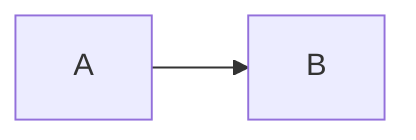

# Markdown

Markdown is a plain text format that converts to HTML. You write in an easy-to-read, easy-to-write syntax and tools render it. Most platforms (GitHub, GitLab, [[obsidian]], [[joplin]]) use CommonMark with extensions, often called GitHub Flavored Markdown (GFM).

Documentation: [Markdown Docs](https://daringfireball.net/projects/markdown/)
Spec: [CommonMark](https://commonmark.org/) and [GFM](https://github.github.com/gfm/)
RFC: [RFC 7763](https://www.rfc-editor.org/rfc/rfc7763) (media type)
GitHub Documentation: [Writing Markdown on GitHub](https://docs.github.com/en/get-started/writing-on-github)

---
## Cheat-Sheet

### Headings
```markdown
# Heading 1
## Heading 2
### Heading 3
#### Heading 4
##### Heading 5
###### Heading 6
```

Write `# Heading` with a space after the `#`. `#Heading` is not a heading in most renderers.

### Emphasis
```markdown
Emphasis, aka italics, with *asterisks* or _underscores_.

Strong emphasis, aka bold, with **asterisks** or __underscores__.

Combined emphasis with **asterisks and _underscores_**.

Strikethrough uses two tildes. ~~Scratch this.~~
```

### Line Breaks and Paragraphs
```markdown
A blank line starts a new paragraph.

End a line with two spaces  
or a backslash\
to force a line break inside a paragraph.
```

### Lists

#### Ordered Lists
```markdown
1. First item
2. Second item
3. Third item
```

#### Unordered Lists
```markdown
- First item
- Second item
  - Nested item (indent two or four spaces)
- Third item
```

### Links
```markdown
Link with text: [link-text](https://www.example.com)
Link with title: [link-text](https://www.example.com "Title")
Reference link: [link-text][id]
Bare URL: <https://www.example.com>

[id]: https://www.example.com
```

### Images
```markdown
Image with alt text: 
Image without alt text: 
Image that links: [](https://www.example.com)
```
Always give an alt text for accessibility.

### Blockquotes and Rules
```markdown
> A quote
> over two lines

---
```
GitHub also supports alerts: `> [!NOTE]`, `> [!TIP]`, `> [!IMPORTANT]`, `> [!WARNING]`, `> [!CAUTION]` as the first line of a quote.

### Code

#### Inline Code
```markdown
Inline `code` has `back-ticks around` it.
```

#### Blocks of Code
Fence with three backticks (or `~~~`) and name the language for highlighting:

````markdown
```javascript
var s = "JavaScript syntax highlighting";
alert(s);
```

```python
s = "Python syntax highlighting"
print(s)
```

```
No language indicated, so no syntax highlighting.
```
````
To show a fence inside a fence, use four backticks on the outside (as above).

### Tables

Separate the header from the body with at least three dashes per column. Outer pipes are optional and the raw text does not need to line up. Use `:---`, `:---:` and `---:` for left, centre and right alignment. Escape a literal pipe in a cell as `\|`.

```markdown
| Heading 1 | Heading 2 | Heading 3 |
|---|:---:|---:|
| col1 | col2 | col3 |
| col1 | col2 | col3 |
```

### Task List

Start a list item with `[ ]` for open or `[x]` for done:

```markdown
- [x] Write the post
- [ ] Update the website
- [ ] Contact the user
```

### Footnotes, Escaping and HTML
```markdown
A claim with a footnote.[^1]

[^1]: The footnote text.

Escape special characters with a backslash: \* \_ \# \`
<details><summary>Click to expand</summary>

Hidden content (leave blank lines around Markdown inside HTML).

</details>
```
Footnotes are supported by GitHub and most editors, but not by every renderer.

### Diagrams and Math (GitHub)
````markdown

````
Inline math is `$a^2 + b^2$` and block math uses `$$ ... $$`.

## Tips
- Keep one top-level `#` heading per file.
- Lint with `markdownlint` (VS Code extension or `npx markdownlint-cli2 "**/*.md"`). See [[vscode]].
- Convert with `pandoc file.md -o file.html` (or `.pdf`, `.docx`).
- Wikilinks like `[[page]]` are an Obsidian and wiki convention, not standard Markdown. On GitHub use normal links.

## Reference

Link: [markdown guide](https://www.markdownguide.org/cheat-sheet)
