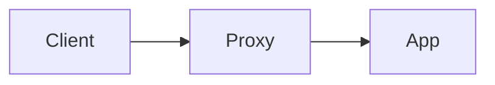
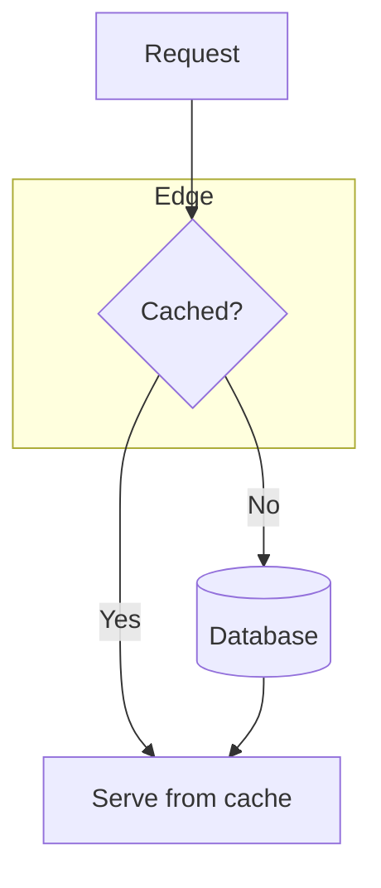
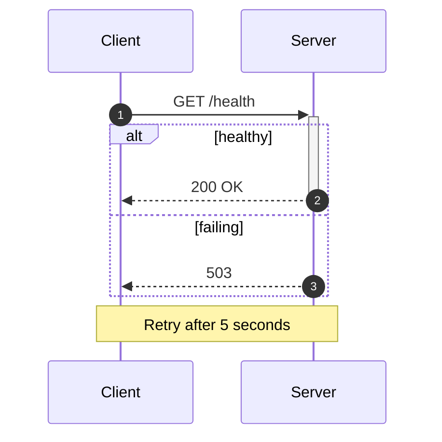
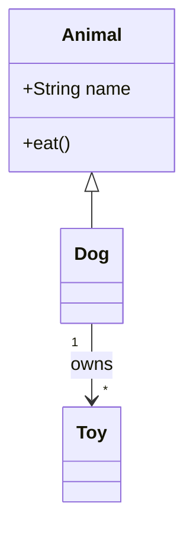
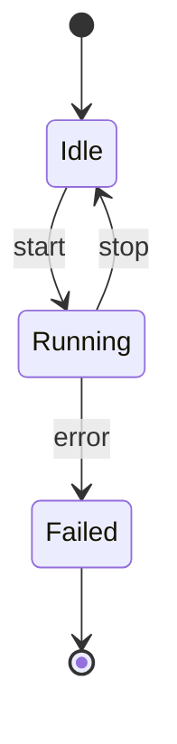
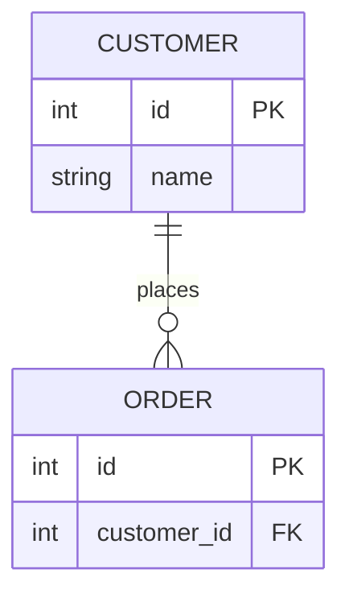
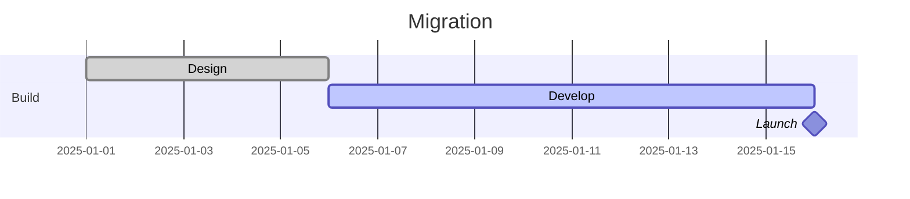
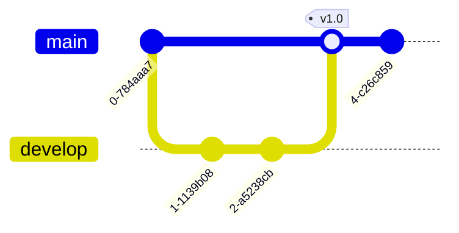
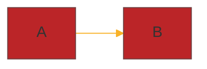

# Mermaid
Mermaid draws diagrams from plain text: flowcharts, sequence, class, state, ER, Gantt and Git graphs. Write it in a fenced `mermaid` block so it renders on GitHub and in many editors, or render files with `mmdc` (mermaid-cli).

Documentation: [Mermaid documentation](https://mermaid.js.org/intro/) · [Mermaid CLI](https://github.com/mermaid-js/mermaid-cli) · [GitHub: creating diagrams](https://docs.github.com/en/get-started/writing-on-github/working-with-advanced-formatting/creating-diagrams)
Project: [Mermaid](https://mermaid.js.org/)

Verification: syntax checked against the Mermaid documentation and the mermaid-cli source. The diagrams were not rendered locally (mermaid-cli needs a bundled Chromium), so a version difference or typo is possible. Test in the [Mermaid Live Editor](https://mermaid.live/).

## Basics
ITEM | DESCRIPTION
---|---
` ```mermaid ` | Fence that starts a diagram in Markdown (close with ` ``` `)
First line | Diagram type keyword, e.g. `flowchart LR`, `sequenceDiagram`, `erDiagram`
`%% comment` | Comment line
`.mmd` file | Plain Mermaid text for `mmdc` and editors
Lower-case `end` | Breaks flowcharts if used inside a label: write `End`
Quote labels | `A["Text with (brackets)"]` for special characters

````markdown

````

## Flowchart
`graph` is an older alias of `flowchart`. Direction is `TB` (or `TD`), `BT`, `LR` or `RL`.

SYNTAX | DESCRIPTION
---|---
`flowchart TD` | Start a top-down flowchart
`A[Text]` | Rectangle
`A(Text)` | Rounded
`A([Text])` | Stadium
`A[[Text]]` | Subroutine
`A[(Text)]` | Cylinder (database)
`A((Text))` | Circle
`A{Text}` | Diamond (decision)
`A{{Text}}` | Hexagon
`A[/Text/]` | Parallelogram
`A@{ shape: cyl, label: "Text" }` | Extended shape form (Mermaid 11.3.0 and later)
`A --> B` | Arrow
`A --- B` | Line without arrowhead
`A -->\|Yes\| B` or `A -- Yes --> B` | Labelled arrow
`A -.-> B` | Dotted arrow
`A ==> B` | Thick arrow
`A ~~~ B` | Invisible link (layout only)
`A --> B & C` | One source, several targets
`A --> B --> C` | Chain
`subgraph ID [Title]` ... `end` | Group nodes
`direction LR` | Direction inside a subgraph
`classDef NAME fill:#f9f,stroke:#333` | Define a style class
`class A,B NAME` or `A:::NAME` | Apply a class
`style A fill:#f9f` | Style one node
`linkStyle 0 stroke:#f00` | Style a link by its position (zero-based)
`click A "https://example.com" "Tooltip"` | Link a node (disabled at the strict security level)



## Sequence Diagram
SYNTAX | DESCRIPTION
---|---
`participant A as Alice` | Declare and alias a participant (sets the order)
`actor B` | Participant drawn as a person
`A->>B: Text` | Solid line with arrowhead
`A-->>B: Text` | Dotted line with arrowhead (replies)
`A->B: Text` / `A-->B: Text` | Line without arrowhead
`A-xB: Text` | Solid line with a cross (failed)
`A-)B: Text` | Open arrow (asynchronous)
`A->>+B: Text` / `B-->>-A: Text` | Activate and deactivate B
`activate B` / `deactivate B` | Same, as separate lines
`Note right of B: Text` | Note beside a participant (`left of` also works)
`Note over A,B: Text` | Note across participants
`autonumber` | Number the messages
`loop Text` ... `end` | Repeat
`alt Text` ... `else Text` ... `end` | Alternatives
`opt Text` ... `end` | Optional
`par Text` ... `and Text` ... `end` | Parallel
`critical Text` ... `option Text` ... `end` | Must succeed, with fallback
`break Text` ... `end` | Stop the sequence
`rect rgb(191, 223, 255)` ... `end` | Coloured background block
`box Aqua Group` ... `end` | Group participants (no `#` hex colours)



## Class Diagram
SYNTAX | DESCRIPTION
---|---
`class Animal` | Declare a class
`class Animal { +String name  +eat() }` | Members in braces, one per line
`+` / `-` / `#` / `~` | Public, private, protected, package visibility
`method()*` / `method()$` | Abstract or static method
`Animal <\|-- Dog` | Inheritance
`Car *-- Engine` | Composition
`Library o-- Book` | Aggregation
`A --> B` | Association
`A ..> B` | Dependency
`A ..\|> B` | Realisation
`A "1" --> "*" B : has` | Cardinality and label
`<<interface>> Shape` | Annotation (or put it inside the braces)
`class Box~T~` | Generic type
`direction RL` | Layout direction



## State Diagram
Use `stateDiagram-v2`.

SYNTAX | DESCRIPTION
---|---
`[*] --> Idle` | Start state
`Done --> [*]` | End state
`Idle --> Running : start` | Transition with a label
`state "Long name" as S1` | Alias for a state
`state Group { ... }` | Composite (nested) state
`state C <<choice>>` | Decision
`state F <<fork>>` / `state J <<join>>` | Fork and join
`--` inside a composite state | Separate concurrent regions
`note right of Idle : Text` | Note (`left of` also works)
`direction LR` | Layout direction



## ER Diagram
CARDINALITY (LEFT\|RIGHT) | MEANING
---|---
`\|o` \| `o\|` | Zero or one
`\|\|` \| `\|\|` | Exactly one
`}o` \| `o{` | Zero or more
`}\|` \| `\|{` | One or more

SYNTAX | DESCRIPTION
---|---
`A \|\|--o{ B : places` | Identifying relationship (solid line) with a label
`A }o..o{ B : is` | Non-identifying relationship (dashed line)
`A { string name PK }` | Attributes in braces, one `type name` per line
`PK`, `FK`, `UK` | Key markers after the attribute; combine as `PK, FK`
`string phone "Comment"` | Quoted comment at the end of an attribute line



## Gantt
SYNTAX | DESCRIPTION
---|---
`gantt` | Start a Gantt chart
`title Plan` | Chart title
`dateFormat YYYY-MM-DD` | Format of input dates
`axisFormat %d/%m` | Format of the axis labels
`section Name` | Group of tasks
`Task :done, id1, 2025-01-01, 5d` | Task with status, ID, start date and duration
`Task :active, id2, after id1, 10d` | Starts when `id1` ends
`Task :crit, id3, after id2, 3d` | Critical task
`Release :milestone, m1, after id3, 0d` | Milestone



## Git Graph
SYNTAX | DESCRIPTION
---|---
`gitGraph` | Start a graph (add `LR:`, `TB:` or `BT:` for orientation)
`commit` | Commit on the current branch
`commit id: "A" tag: "v1.0"` | Commit with an ID and a tag
`commit type: HIGHLIGHT` | Commit type: `NORMAL`, `REVERSE` or `HIGHLIGHT`
`branch develop` | Create and switch to a branch
`checkout main` | Switch branch
`merge develop` | Merge a branch into the current one
`cherry-pick id: "A"` | Copy a commit from another branch



## Themes and Configuration
Theme names (Mermaid documentation): `default`, `neutral`, `dark`, `forest`, `base`, plus newer looks such as `neo`, `neo-dark`, `redux`, `redux-dark`, `redux-color` and `redux-dark-color` on recent versions. Only `base` accepts custom `themeVariables`.

Frontmatter at the top of the diagram is the current method:



The older `init` directive still works and goes on the line before the diagram:

```text
%%{init: {"theme": "forest", "flowchart": {"curve": "linear"}}}%%
```

OPTION | DESCRIPTION
---|---
`theme` | Theme name
`themeVariables` | Colours and fonts (with `base`), e.g. `primaryColor`, `lineColor`, `fontFamily`
`flowchart.curve` | Link shape, e.g. `linear`
`sequence.wrap` | Wrap long messages
`securityLevel` | `strict` (default) disables `click` links and scripts; `loose` enables them
`look` / `layout` | Visual style and layout engine on recent versions (unverified: check your version's docs)

## GitHub and Editors
WHERE | NOTES
---|---
GitHub | Renders `mermaid` blocks in Markdown files, issues, discussions, pull requests and wikis
GitHub version | A `mermaid` block containing only `info` shows the version GitHub runs, which may lag behind the docs
Obsidian, Joplin, VS Code | Render `mermaid` blocks natively or with an extension (see [Obsidian](obsidian.md), [Joplin](joplin.md) and [VSCode (Visual Studio Code)](vscode.md))
Third-party plugins | Not available on GitHub, and may cause errors

## mermaid-cli (mmdc)
Install with `npm install -g @mermaid-js/mermaid-cli`, or run it with `npx -p @mermaid-js/mermaid-cli mmdc`. It drives a headless Chromium through Puppeteer.

COMMAND | DESCRIPTION
---|---
`mmdc -i <INPUT>.mmd -o <OUTPUT>.svg` | Render to SVG (PNG and PDF by file extension)
`mmdc -i <INPUT>.mmd -o <OUTPUT>.png -s 2` | PNG at scale 2
`mmdc -i <INPUT>.mmd -o <OUTPUT>.png -t dark -b transparent` | Theme and background
`mmdc -i <INPUT>.mmd -o <OUTPUT>.png -c <CONFIG>.json` | Mermaid JSON config file
`mmdc -i <INPUT>.mmd -o <OUTPUT>.svg -C <STYLE>.css` | Custom CSS (used as `themeCSS`)
`mmdc -i <INPUT>.mmd -o <OUTPUT>.pdf --pdf-paper-format A4` | PDF with a paper size
`mmdc -i <INPUT>.md -o <OUTPUT>.md` | Render each `mermaid` block in a Markdown file to an image and rewrite the links
`mmdc -i <INPUT>.md -o <OUTPUT>.md -a <DIR>` | Write the images to a directory
`mmdc -i - -o <OUTPUT>.svg` | Read the diagram from standard input
`mmdc -p <PUPPETEER>.json -i <INPUT>.mmd` | Puppeteer config (for example launch args in containers)
`mmdc -q ...` | Quiet
`mmdc -h` | All options

Run in Docker without installing Node: `docker run --rm -u "$(id -u):$(id -g)" -v "$PWD:/data" minlag/mermaid-cli -i diagram.mmd -o diagram.svg`. In a container as root, Chromium may need `{"args": ["--no-sandbox"]}` in the Puppeteer config (unverified here).

## Troubleshooting
SYMPTOM | FIX
---|---
`Syntax error in text` | Check the first line keyword, unclosed quotes or brackets and a stray `end`
Diagram works in the live editor but not on GitHub | GitHub's Mermaid version is older; use `info` to check it and avoid newer syntax
Label with `(`, `)`, `:` or `#` breaks | Wrap the label in double quotes
Flowchart ends at a node called `end` | Capitalise it (`End`) or quote it
`A---oB` draws a circle edge | Add a space or change the case (`A --- oB`)
`click` does nothing | The security level is `strict`; click links need `loose`
`mmdc` fails to launch the browser | Install Chromium dependencies, or pass `-p` with `--no-sandbox` in a container

## See Also
- [Markdown](../misc/markdown.md)
- [Obsidian](obsidian.md)
- [Joplin](joplin.md)
- [VSCode (Visual Studio Code)](vscode.md)
- [Git](git.md)
